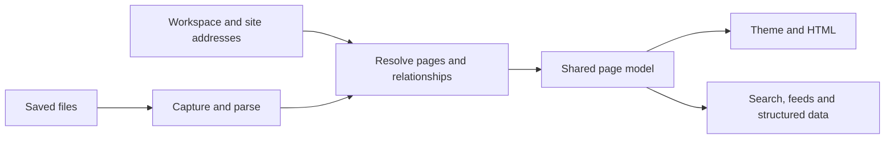

# Gazette architecture

Gazette publishes a body of thought from the whole to its parts, and makes that structure what readers, search, feeds, JSON-LD and `llms.txt` index. It builds a publication from its writing, workspace and Theme: the compiler resolves a page's identity, relationships and address once, and HTML, search, feeds and structured data use that same result. Among the products [RawThoughts](https://rawthoughts.in/) builds, Gazette carries approved work outward, and it works as a product of its own. To make a publication, start with [Your first publication](https://rawthoughts.in/gazette/first-publication/).

## The inputs to a publication

The workspace configuration names the sites to build, their content sources and their themes. Writing can stay in several repositories or directories: the workspace selects the sources that contribute to each site. A theme supplies templates, styles and other resources for its presentation.

Publication names, domains, source selections and publisher choices belong in the writing and workspace. The engine resolves those declarations; a theme presents the resulting values. Keeping site values out of shared engine and theme code lets another publisher use the same behavior without inheriting someone else’s identities or destinations.

Gazette reads those files into memory before compiling them. That lets a build use the same captured article throughout, even if someone saves another edit while it is rendering. The [workspace guide](workspace-sources.md#publication-acquisition) explains how to select local directories and Git repositories.

## Follow an article through the build



An article's identity, title and address serve different purposes. For example, these metadata fields identify one article:

```toml
[content]
id = "content:arrival-note"
title = "Early arrivals"
route = { path = "/early-arrivals/" }
```

The ID identifies the article in collection membership and other declared relationships. The title is what readers see. The route determines its address. If its title changes to **Before the crowd** while its ID and route stay the same, it remains the same article at `/early-arrivals/`, in the same collection. The following stages carry that change into the site.

### Parse the writing

Gazette reads the article's metadata and parses its Markdown body. The Markdown adapter returns headings, links and other document structure together with their locations in the source. Gazette uses those locations to report a broken reference beside the text that caused it.

The compiler then interprets that structure as a publication: an article can belong to a collection, credit an author and link to another page. The [content model](content-model.md) describes those declarations.

### Resolve the relationships

The **Field Notes** collection identifies its member by `content:arrival-note`, so it still contains the renamed article. The article also links to **Station map**, a page on a second site called **Travel Guide**. The workspace gives Travel Guide the public base `https://travel.example/`; Station map declares the route `/station-map/`. Gazette resolves the link to `https://travel.example/station-map/`. In a local preview that address can use the destination's local listener; a public build uses its public base URL.

This is also where Gazette detects missing destinations, conflicting identities and invalid relationships. Every consumer receives the resolved destination rather than calculating an address independently. See [links and crossings](links-and-crossings.md) and [routing](routing.md).

### Render the result

The theme receives the article's body, title, navigation and resolved links as page context. It decides how to present them. The Field Notes listing and search index now receive **Before the crowd** as its title and `/early-arrivals/` as its route. The article's Station map link receives the address resolved above. Those values come from the same resolved publication.

Feeds, sitemaps and JSON-LD also use that model. They can describe the same article at the same canonical address without each output reparsing the original Markdown. The [theme contract](theme-reference.md) defines the values a template receives; the [Tera guide](tera.md) shows how to use them.

### Trusted code and saved results

Theme templates and external generators are trusted code. Capturing their inputs and bounding accepted output do not make their execution a sandbox. A generator runs with its process permissions; its staging directory determines where Gazette puts files, not what the generator can access. Review the selected programs and their build scripts before running them.

Browser-module compilation removes supported TypeScript type syntax but does not type-check the program. Stylesheets and notebook output have their own supported profiles; Gazette displays saved notebook results without running cells. The [theme contract](theme-reference.md#markup-and-execution-gates), [resource guide](page-resources.md) and [generator guide](documentation-generators.md) explain those limits.

## Compilation and host operations

The compiler resolves relationships in memory. The application asks the host to read a directory, start a preview server or write output only when the operation needs it. This lets an editor use the same compiler to check an unsaved document.

The compiler works with captured inputs and shared data types. When an operation needs filesystem, rendering or storage access, it uses a **port**: a Rust interface describing that capability. An **adapter** implements it, such as the filesystem adapter for local reads or the Tera adapter for templates. The application coordinates these operations, and the SDK assembles the capabilities a program needs.

The SDK's [architecture test](../sdk/rust/tests/architecture.rs) reads Cargo's actual dependency graph and checks the permitted production dependencies between Gazette crates: core depends on no other Gazette crate, ports depend on core, compiler on core and ports, and application on those three. Host adapters remain outside that chain. The test checks crate dependencies; the port and adapter design determines where host operations belong.

For example, an editor can analyse a document while you type using its in-memory text. A publication preview additionally needs the configured files, theme rendering and local listeners. Its application operation acquires those capabilities before serving the result. The [preview guide](preview.md) explains the session lifecycle; [local rendering](local-rendering.md) covers build results and failures.

## Share behavior across interfaces

The CLI, agent tools and editor integrations use the same compiler through Gazette's SDK. They adapt its operations to different callers:

| Interface | When to use it |
| --- | --- |
| CLI | Check, build, preview or release a publication from a shell |
| MCP | Let an agent call Gazette operations with structured requests and results |
| LSP | Add diagnostics, navigation and supported edits to an editor |
| Node SDK | Embed Gazette in a Node application through Node-API |

One [operation registry](../interfaces/cli/src/command/metadata.rs) supplies the shared operation names and CLI families used by grouped help, MCP discovery and the editor's command routes. The [interface coverage test](../interfaces/launcher/tests/interface_coverage.rs) compares the actual CLI commands, initialized MCP catalogue and VS Code routes, including every declared mode, so adding an operation must preserve its reachability through those interfaces.

An editor supplies its current document buffers for analysis. A filesystem build reads saved files from the configured sources, so save an edit before expecting it in that preview. These operations reuse Gazette's parsers and heading/reference analysis. A new interface translates its protocol into the existing SDK operations instead of implementing another parser or route resolver.

For integration examples, use the [JavaScript SDK](../sdk/js/README.md#check-a-configuration-and-locate-a-field), [MCP quickstart](mcp-quickstart.md) or [language-server guide](lsp.md).

## Build and deliver independently

Gazette can build and preview a publication from its configured writing, sources and theme without Pale or Weave. Optional fact providers and publisher-specific policy checks extend that input and review process; they do not replace the workspace’s publication choices or turn themes into live query clients. The supported fact-provider behavior and proposed evidence records are distinguished below.

A valid publication model does not establish that its writing is public or approved. Candidate policy checks inspect declarations and their uses; output disclosure checks inspect rendered files. Neither grants publication permission. Writing output to a local directory, preparing an authorized release and delivering it are separate operations; follow [output materialization](output-materialization.md), [policy checks](policy-checks.md) and [release preparation](releasing.md) for their contracts.

The delivery path uses Git for objects and refs and the GitHub integration for Pages build observations. A successful push does not establish what readers receive: [served-output observations](delivery.md) compare selected routes with the expected bytes. Cloudflare and Vercel delivery adapters remain future integration work. After a lost delivery response, inspect the recorded outcome before retrying; a missing response does not establish that the write or push failed.

## Where to extend Gazette

Choose the part that owns the behavior you want to change:

| Change | Start with | Checks to extend |
| --- | --- | --- |
| Add a content relationship or change how it resolves | `crates/gazette-compiler/src/authored/` and the [content model](content-model.md) | [Content graph tests](../crates/gazette-core/tests/content_graph.rs) check membership, ordering, missing targets and cycles. |
| Change a page's appearance or add a theme component | The [theme contract](theme-reference.md) and [Tera templates](tera.md) | [Tera adapter tests](../adapters/tera/tests/render.rs) exercise captured templates, inheritance, escaping and limits; inspect the changed theme in the browser too. |
| Connect a new storage mechanism | The storage port and [store API](store.md) | [Application placement tests](../crates/gazette-application/tests/store_placement.rs) protect source/output separation; the existing SQLite [connection](../adapters/sqlite/tests/internal/connection.rs) and [writer](../adapters/sqlite/tests/internal/writer.rs) tests demonstrate read permissions and transaction checks. |
| Add an editor or agent integration | The shared SDK, [LSP](lsp.md) or [MCP](mcp.md) contract | [LSP protocol tests](../interfaces/lsp/tests/protocol.rs) exercise framed messages and editor state; [interface coverage](../interfaces/launcher/tests/interface_coverage.rs) checks CLI, MCP and editor operation reachability. |

A build produces output to inspect. Use the [release workflow](releasing.md) to prepare, approve and deliver it, and the [source-build guide](install.md#checks-before-a-change) to check an implementation change.

## Proposed optional fact evidence

A future integration could attach evidence to a selected fact for a publisher's checker. The proposed record would identify the fact and its owner, source revision and digest, validity or replacement, permitted public fields, relationship evidence and applicable consent. This is an optional design proposal, not an implemented schema or a required record for every person, organisation, brand or publishing fact.

The current compiler validates declarations and references. External-fact providers can supply the supported display-name field through the existing [fact port](../crates/gazette-ports/src/facts.rs), and [configured policy checks](policy-checks.md) can evaluate a publisher's own rules. Neither mechanism authenticates all of the proposed evidence or grants publication permission. A future record must preserve those distinctions and leave the source owner's meaning and permitted use with that owner.
