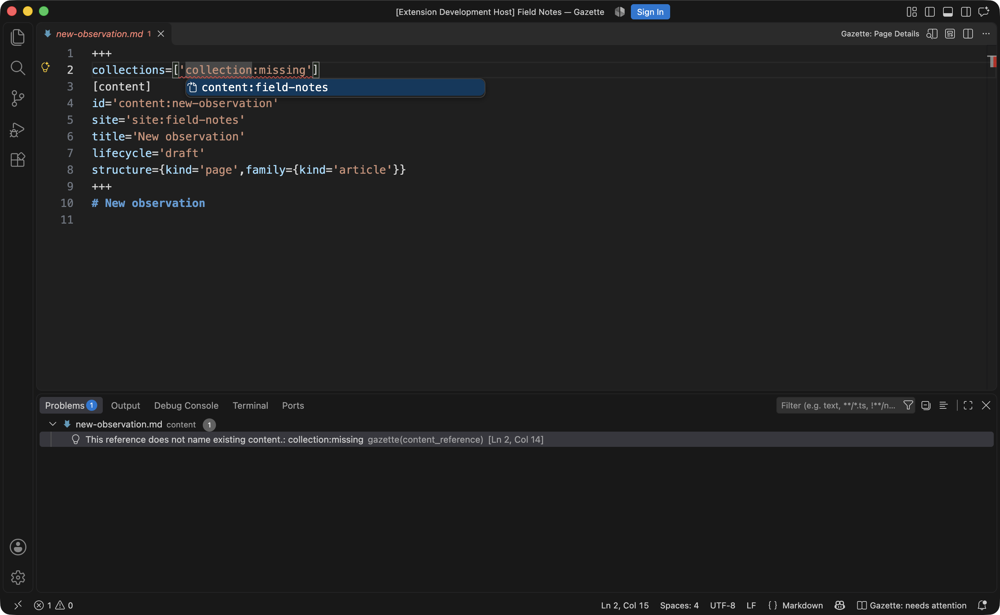

# Gazette editor integration

Extend Gazette's VS Code client without duplicating compiler behavior. The extension connects a workspace to the language server, starts application operations through MCP and presents diagnostics, navigation and reviewed edits.

Use [the integration guide](../../docs/vscode.md) to load the extension or debug its connection. To edit your publication, follow [Write in VS Code](https://rawthoughts.in/gazette/write-with-feedback/).

## Build and check

From the repository root:

```sh
npm --prefix integrations/vscode ci --ignore-scripts
npm --prefix integrations/vscode run check
```

`check` typechecks, compiles and runs the Node tests. `npm run build` inside this directory compiles the test modules into ignored `dist/` and bundles the installed extension into ignored `bundle/` with esbuild. The package contains the client bundle, its dependency notices and the language client's process-shutdown helper; test modules and `node_modules` stay out of the VSIX. Edit `src/`, never the generated JavaScript. Building does not install Gazette or change editor settings. The [source-checkout launch procedure](../../docs/vscode.md#open-the-local-extension-from-a-source-checkout) owns the executable selection, separate development window and connection check.

To prepare a local VSIX, first build the Gazette executable for this host, then run the following from this directory after the checks pass. [Installed-extension help](INSTALL.md) becomes its details page; this README remains the source contributor's guide. The package includes that executable and the bundled client. Packaging does not publish or install the extension.

```sh
npm run package -- --server /absolute/path/to/gazette --out /absolute/path/to/gazette.vsix
```

The packaging tool checks the program's reported target, builds the client and assembles a temporary package beneath ignored `dist/`, with the native program in `server/`. It generates and checks fresh distribution notices in that same directory from the locked source inputs, rather than copying the held source-root inventory. It copies the installed help to that package's `README.md`, creates a platform-specific VSIX with pinned VSCE, then removes the temporary package. Run it on macOS or Linux, on arm64 or x64, with the matching native build; other targets are not supported by this tool. The offline generator needs the locked Cargo dependencies in the local cache; run `cargo fetch --locked` from the repository root when preparing a new build environment. The installed extension uses its bundled program when the User setting is empty. A source-checkout development host still needs an explicit User executable setting because no program is retained in the checkout.

## Where to change the client

| Responsibility | Source |
| --- | --- |
| Activation, selected folders and language-server lifecycle | [extension.ts](src/extension.ts) |
| Application operation selection and dispatch | [applicationCommands.ts](src/applicationCommands.ts) |
| Folder-bound native MCP transport | [applicationSession.ts](src/applicationSession.ts) |
| Named application command routes | [applicationCommandCatalog.json](src/applicationCommandCatalog.json) |
| Extension contributions and configuration declarations | [package.json](package.json) |

The route catalog names operations; live native discovery supplies their schemas, effects and lifecycle relationships. Change the native owner when an operation's meaning changes. The client must preserve exact argument/result text and current source/version checks rather than adding its own parser or policy model.

## Application operations

The [application operation contract](../../docs/vscode.md#explicit-application-operations) owns the picker, guided/advanced requests, confirmation, receipts, canonical follow-up preparation and session retirement. It also explains how an uncertain post-dispatch outcome differs from a refusal before dispatch. Do not recreate those rules in command-specific handlers.

## Current editor context

[Visible authoring context](../../docs/vscode.md#visible-authoring-context) and [sessions and overlays](../../docs/vscode.md#sessions-and-overlays) describe source selection, unsaved buffers, recapture and stale-result rejection. [Editor context and export](../../docs/vscode.md#editor-context-and-export) owns the read-only MCP handoff and private export. A source-setting change refreshes its authoring composition; it does not retire a separate application session.

## Use the native editor features

[The editor feature map](../../docs/vscode.md#editor-context-and-export) connects Open Link, definitions/references, symbols, hover, reviewed fixes and page companions to their shared native contracts. The [LSP reference](../../docs/lsp.md) defines source precision and protocol results.

<a id="transport-qualification"></a>

## Test a client change

Run `npm --prefix integrations/vscode run check` after changing the client. It type-checks, compiles and runs the Node tests. Test the affected command in an actual VS Code development window too; a simulated client cannot show whether the editor presents the right diagnostic, source or action.

When updating the language client, check diagnostic versions and handler registration order. The native [LSP contract](../../docs/lsp.md) defines the source and version checks the extension must preserve.

The installed help and changelog travel with the package. The screenshot below shows the native missing-reference diagnostic and collection completion in the generated Field Notes starter. Its PNG is included in `media/`, but VS Code's installed Details view does not render relative image links. Adding this image to the installed help therefore awaits an approved public image address. Before public distribution, set the approved repository address and extension icon, check the public help and image links, and qualify each platform package. The changelog marks the current candidate as unreleased until that work and publication are complete.


